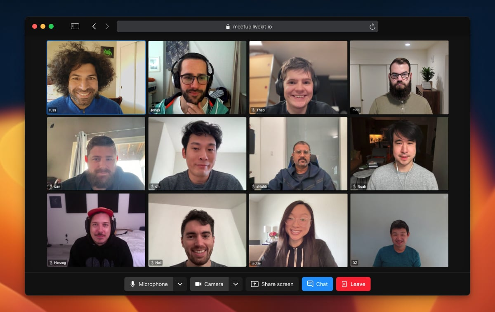

# LiveKit Meet

  <a href="https://meet.livekit.io"><strong>Try the demo</strong></a>
  •
  <a href="https://github.com/livekit/components-js">LiveKit Components</a>
  •
  <a href="https://docs.livekit.io/">LiveKit Docs</a>
  •
  <a href="https://livekit.io/cloud">LiveKit Cloud</a>
  •
  <a href="https://blog.livekit.io/">Blog</a>

 

LiveKit Meet is an open source video conferencing app built on [LiveKit Components](https://github.com/livekit/components-js), [LiveKit Cloud](https://cloud.livekit.io/), and Next.js. It's been completely redesigned from the ground up using our new components library.

## Tech Stack

- This is a [Next.js](https://nextjs.org/) project bootstrapped with [`create-next-app`](https://github.com/vercel/next.js/tree/canary/packages/create-next-app).
- App is built with [@livekit/components-react](https://github.com/livekit/components-js/) library.

## Demo

Give it a try at https://meet.livekit.io.

## Dev Setup

Steps to get a local dev setup up and running:

1. Run `pnpm install` to install all dependencies.
2. Copy `.env.example` in this folder to `.env.local`.
3. Fill in `LIVEKIT_URL`, `LIVEKIT_API_KEY` and `LIVEKIT_API_SECRET` in `.env.local`. Keep the key and secret without a `NEXT_PUBLIC_` prefix so they never reach the browser.
4. Run `pnpm dev` to start the development server and visit [http://localhost:3000](http://localhost:3000) to see the result.
5. Start development 🎉
